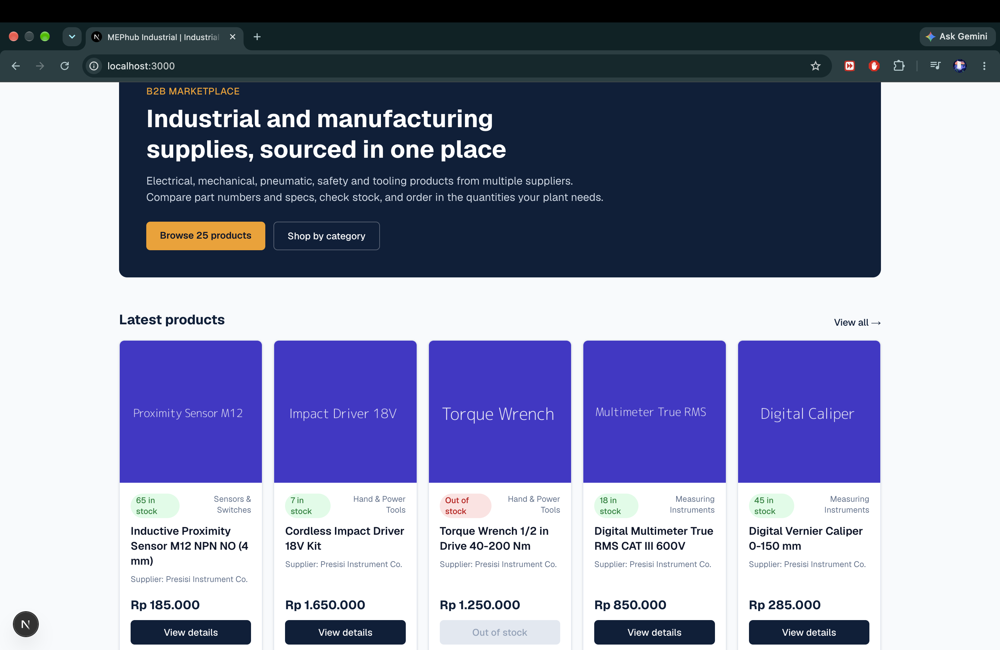
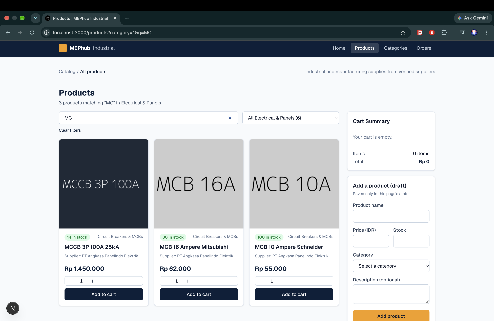
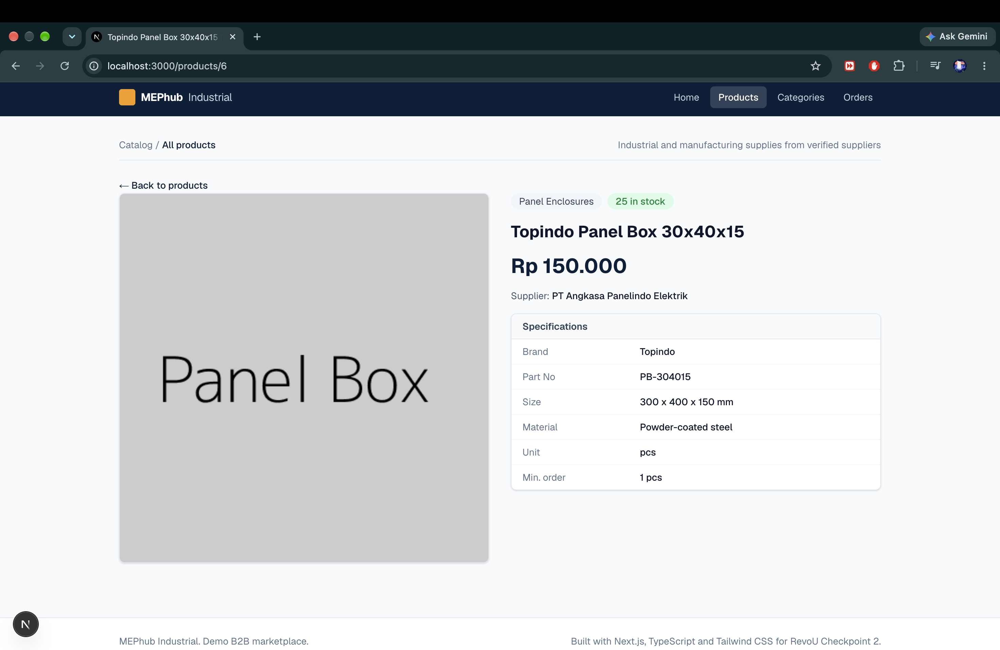
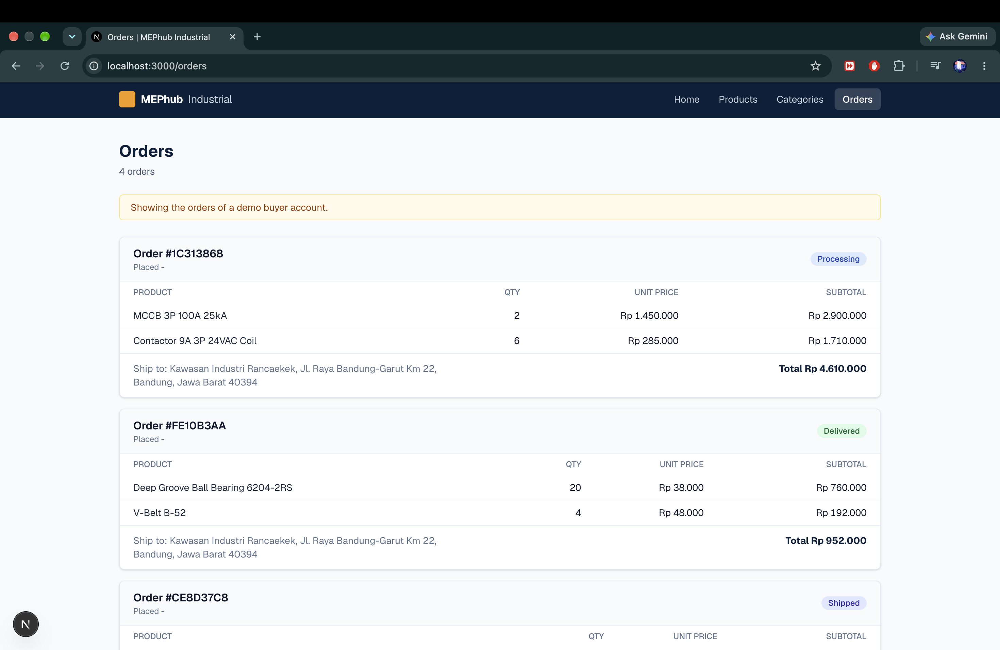
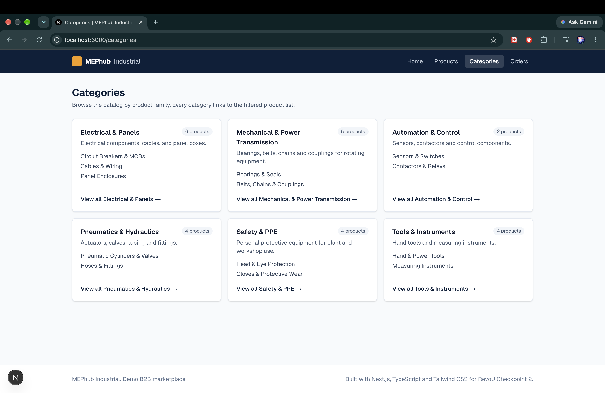
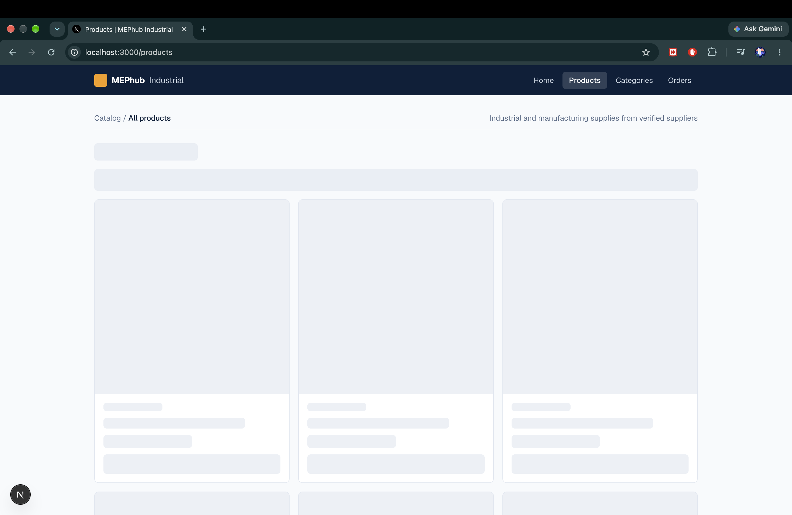
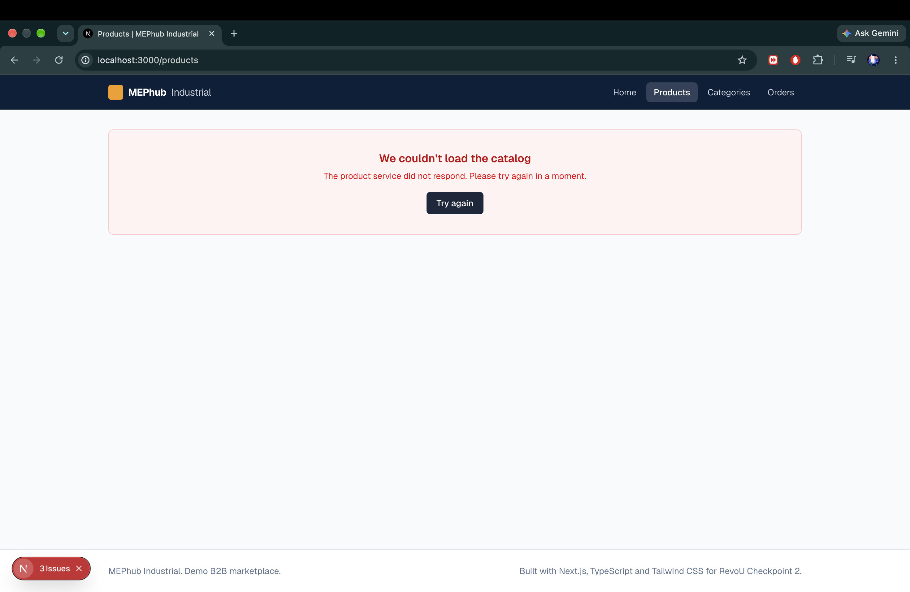

# MEPhub Industrial (Frontend)

A B2B marketplace frontend for **industrial and manufacturing supplies**: electrical, mechanical, pneumatic, safety and tooling products from multiple suppliers. Built for RevoU's Full-Stack Software Engineering program, **Module 3 Checkpoint 2**, with Next.js (App Router), React, TypeScript and Tailwind CSS.

It consumes the Flask REST API from Module 2: [multivendor-ecommerce-backend](https://github.com/mfaujian/multivendor-ecommerce-backend) (live docs: https://multivendor-ecommerce-backend.up.railway.app/swagger-ui/).

## Features implemented

- **Home** (`/`): hero section, the 5 latest products and category shortcuts, fetched on the server.
- **Products** (`/products`): live search and category filter that write to the URL (`?q=`, `?category=`) and refetch from the API, with pagination.
- **Product detail** (`/products/[id]`): image, supplier, stock, a specification table parsed from the product description, and a dynamic browser-tab title via `generateMetadata`.
- **Categories** (`/categories`): top-level categories with product counts and links into the filtered catalog.
- **Orders** (`/orders`): orders of a demo buyer account, fetched server-side with a server-only credential.
- **Reusable typed components**: `Header` (active-route styling with `usePathname`), `Footer`, `Card`, `ProductCard` (typed props, optional props with defaults, quantity counter, in-stock / out-of-stock states), `ProductGrid`, `SearchBar`, `AddProductForm` (client-side validation), `CartSummary`.
- **Immutable local state**: add to cart, quantity counter, cart totals, and local product drafts.
- **Loading and error UI**: `loading.tsx` skeletons and `error.tsx` friendly errors on every data-fetching route.

## Tech stack

Next.js 16.4 (App Router, Server Components, Cache Components) · React 19 · TypeScript · Tailwind CSS v4 · ESLint

## Project structure

```
app/                      Routes (each folder is a URL; page.tsx renders it)
  layout.tsx              Root layout: Header + Footer around every page
  page.tsx                Home
  products/
    layout.tsx            Nested layout shared by /products and /products/[id]
    page.tsx              Product list (search, category filter, pagination)
    [id]/page.tsx         Product detail + generateMetadata
  categories/ orders/     Each with page.tsx, loading.tsx, error.tsx
components/               Reusable UI components
hooks/                    useCart (cart state)
lib/                      api.ts (server-only fetchers), auth.ts, config.ts, cart.ts, format.ts, validation.ts
types/                    Shared TypeScript interfaces
```

## Environment variables

Copy `.env.example` to `.env.local` and fill it in. `.env.local` is git-ignored.

| Variable | Where it runs | Purpose |
|---|---|---|
| `NEXT_PUBLIC_API_BASE_URL` | server and browser | Base URL of the Flask API |
| `API_DEMO_EMAIL` | server only | Demo buyer used by `/orders` until real login (Checkpoint 3) |
| `API_DEMO_PASSWORD` | server only | Password of that demo buyer |
| `API_DEMO_DELAY_MS` | server only, optional | Slows API calls down to demo `loading.tsx` |

Variables without the `NEXT_PUBLIC_` prefix are never sent to the browser.

## Run locally

```bash
npm install
cp .env.example .env.local   # then fill in the values
npm run dev                  # http://localhost:3000
```

Other scripts: `npm run lint`, `npm run build`, `npm start`.

## Screenshots









## Checkpoint 3 (next)

Authentication, cart persistence with `localStorage`, checkout (`POST /orders`), the admin dashboard, a Playwright E2E suite, and deployment on Vercel.
