# MEPhub Industrial (Frontend)

A marketplace frontend for **mechanical, electrical and plumbing (MEP) supplies**, built for RevoU's Full-Stack Software Engineering program (Module 3). One catalog serves two kinds of buyers:

- **Individuals (B2C):** browse, add to cart and check out in a few clicks.
- **Businesses (B2B):** search by part number (SKU), see volume prices, paste a parts list into Quick order, add a PO number and a delivery date, and request payment terms.

It consumes the Flask REST API from Module 2: [multivendor-ecommerce-backend](https://github.com/mfaujian/multivendor-ecommerce-backend) (live docs: https://multivendor-ecommerce-backend.up.railway.app/swagger-ui/).

**Live demo:** https://mephub-frontend.vercel.app

## Features implemented

### Checkpoint 2: components, routing and data fetching

- **Home** (`/`): hero section, latest products, category and brand shortcuts, fetched on the server.
- **Products** (`/products`): search by name, part number or brand, plus category, brand, sort and "orderable now" filters that write to the URL (`?q=`, `?category=`, `?brand=`, `?sort=`, `?in_stock=`), with pagination.
- **Product detail** (`/products/[id]`): image, supplier, stock, specification table, volume-price table, datasheet link, and a dynamic browser-tab title via `generateMetadata`.
- **Categories** (`/categories`): top-level categories with product counts and links into the filtered catalog.
- **Reusable typed components:** `Header` (active-route styling with `usePathname`), `Footer`, `Card`, `ProductCard`, `Pagination`, `SearchBar`.
- **Loading and error UI:** `loading.tsx` skeletons and `error.tsx` boundaries on the data-fetching routes.

### Checkpoint 3: forms, authentication and complete backend integration

- **Register and login** (`/register`, `/login`): validated forms; a successful registration logs the user in; invalid credentials show an error; admins land on `/dashboard`, customers on `/`.
- **Session persistence:** the token and user are kept in `localStorage` (`AuthContext`, `useAuth`), so the username in the header survives a refresh.
- **Route guards:** `ProtectedRoute`, `AdminRoute`, `PublicOnlyRoute` redirect unauthorised and logged-out users.
- **Cart** (`/cart`): `AddToCartButton`, `CartContext` saved in `localStorage`, table with quantities, totals and remove buttons, an empty state, and a disabled checkout button when the cart is empty.
- **Checkout** (`/checkout`): saved delivery addresses, PO number, requested delivery date, notes and payment method (bank transfer or payment terms). Confirming calls `POST /orders`, clears the cart and opens `/orders`.
- **Orders** (`/orders`, `/orders/[id]`): list, detail, cancel a pending order, "Order again", and a print-friendly delivery note.
- **Address book** (`/account/addresses`) and **Quick order** (`/quick-order`, paste `SKU, quantity` lines).
- **Admin dashboard:** product CRUD at `/dashboard` (`CreateProductForm`, `EditProductForm`) with a visible error when a product is part of an active order; category CRUD at `/dashboard/categories` (`CreateCategoryForm`) with a guard when products are linked; read-only overview of all orders at `/dashboard/orders`.
- **Toast notifications** (react-hot-toast) for every success and error.
- **End-to-end tests:** 73 Playwright tests.

## Technologies used

Next.js 16 (App Router, Server and Client Components, Cache Components) · React 19 · TypeScript · Tailwind CSS v4 · react-hot-toast · Playwright · `next/navigation` (`useRouter`, `usePathname`, `useSearchParams`, `useParams`) · `localStorage` for session and cart persistence · `NEXT_PUBLIC_API_BASE_URL` for the API address · ESLint

## Project structure

```
app/                      Routes (each folder is a URL; page.tsx renders it)
  layout.tsx              Root layout: Providers, Header and Footer around every page
  page.tsx                Home
  login/ register/        Authentication pages
  cart/ checkout/         Cart and checkout
  quick-order/            Paste a parts list
  account/addresses/      Delivery address book
  products/               Product list, [id] detail, loading.tsx, error.tsx
  categories/             Category listing
  orders/                 My orders and [id] order detail
  dashboard/              Admin: products, categories/, orders/
components/               Reusable UI (forms/ and guards/ inside)
context/                  AuthContext, CartContext
hooks/                    useAuth, useCart, useAsyncData, useDebouncedValue
lib/                      api.ts (server), api-client.ts (browser), cart, validation, format, config
types/                    Shared TypeScript interfaces
tests/                    Playwright end-to-end tests
docs/screenshots/         Images used in this README
```

## Environment variables

Copy `.env.example` to `.env.local` and fill it in. `.env.local` is git-ignored.

| Variable | Where it runs | Purpose |
|---|---|---|
| `NEXT_PUBLIC_API_BASE_URL` | server and browser | Base URL of the Flask API (`http://localhost:5001` locally) |
| `NEXT_PUBLIC_WHATSAPP_NUMBER` | server and browser, optional | Digits only; enables the "Chat for stock and price" link |
| `E2E_ADMIN_EMAIL`, `E2E_ADMIN_PASSWORD` | tests only | Admin account created by the backend seeder |
| `E2E_USER_EMAIL`, `E2E_USER_PASSWORD` | tests only | Customer account created by the backend seeder |
| `API_DEMO_DELAY_MS` | server only, optional | Slows API calls down to demo `loading.tsx` |

Variables without the `NEXT_PUBLIC_` prefix are never sent to the browser. Do not use `#` or `$` in passwords stored in `.env` files.

## Run locally

You need Node.js 22+ and the backend running with the MEP demo data (`python seed_mephub.py --yes`, then `flask run --port 5001`).

```bash
npm install
cp .env.example .env.local   # then fill in the values
npm run dev                  # http://localhost:3000
```

Other scripts: `npm run lint`, `npm run typecheck`, `npm run build`, `npm start`.

Demo accounts (created by the backend seeder): `admin@mephub.id` (admin), `buyer@mephub.id` and `e2e.buyer@mephub.id` (customers). The passwords are the ones you set when seeding.

## Run the tests

```bash
npx playwright install chromium   # once
npm run test:e2e                  # builds the app, starts it, runs all 73 tests
npm run test:e2e:report           # opens the HTML report
```

The tests use the real backend, create their own data (unique names and PO numbers) and clean up after themselves, so they can be repeated. If the app is already running on port 3000 (for example `npm run dev`), Playwright reuses it.

## Screenshots

| | |
|---|---|
| 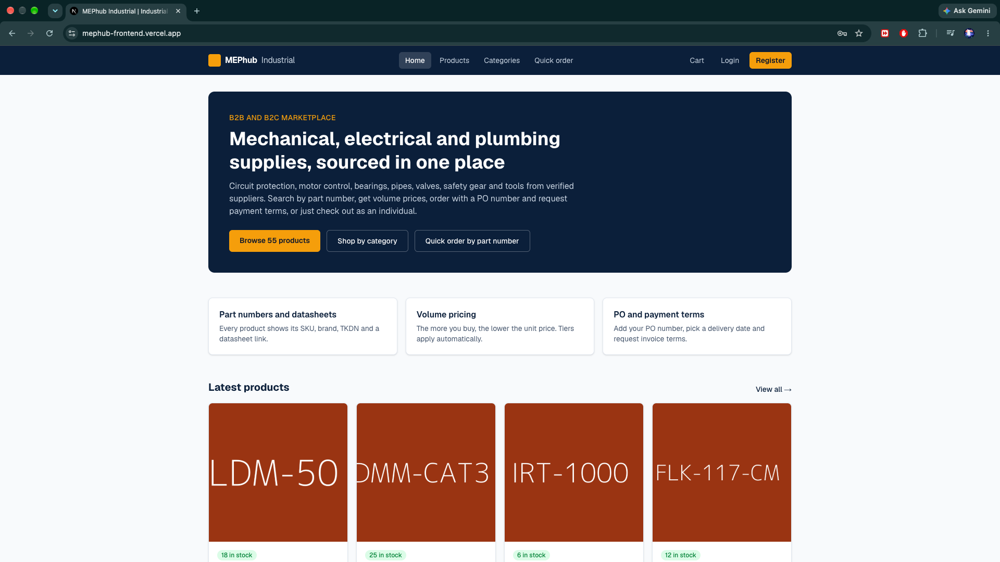 | 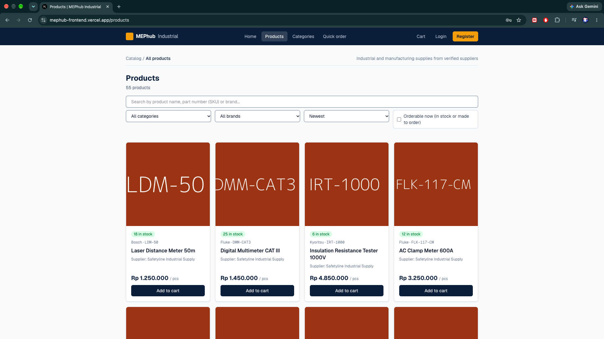 |
| 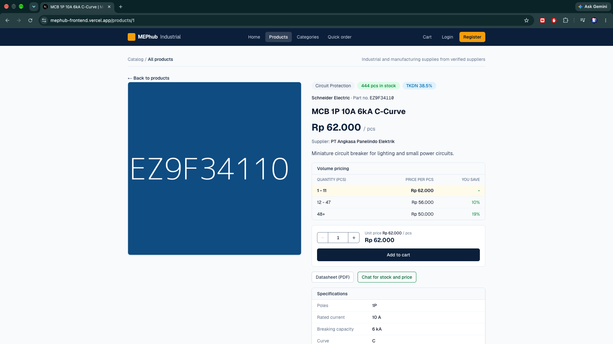 | 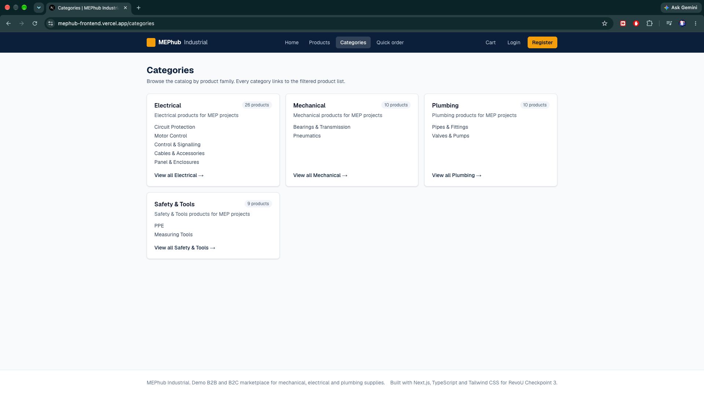 |
| 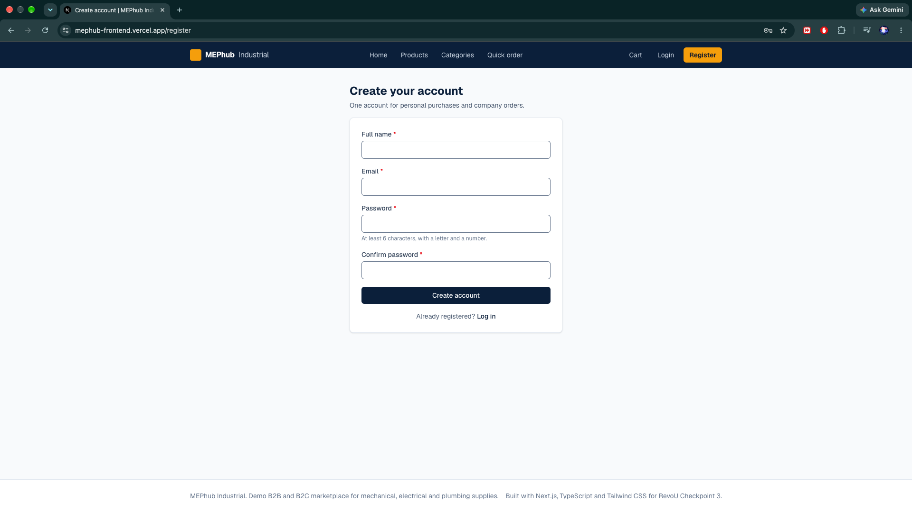 | 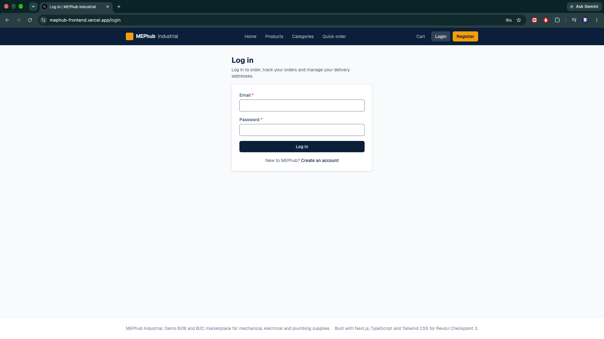 |
| 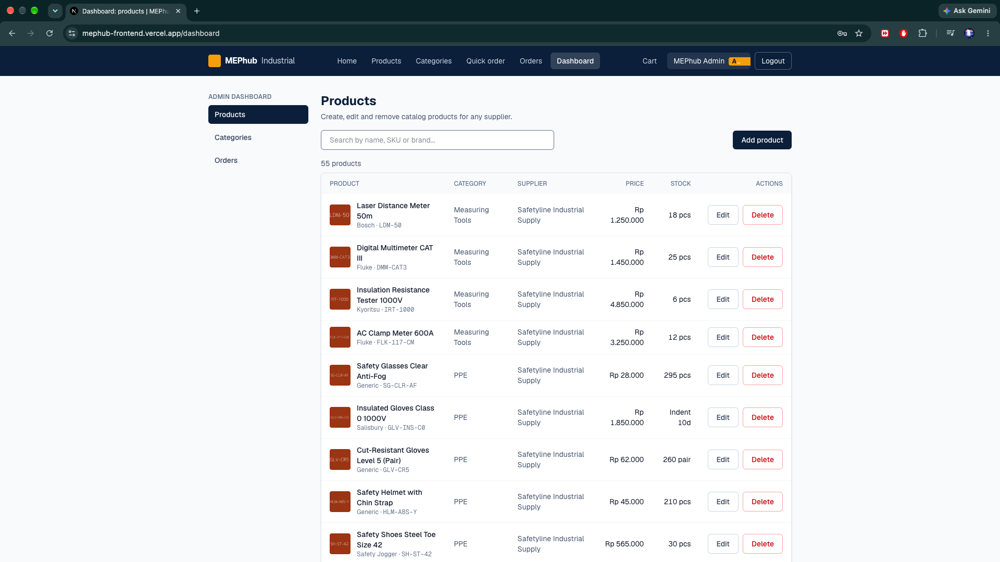 | 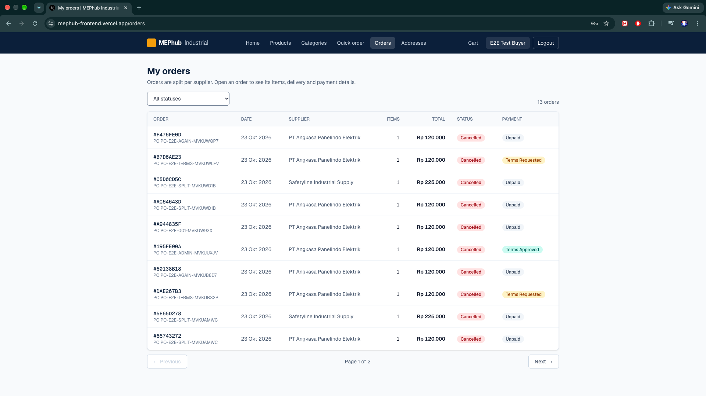 |
| 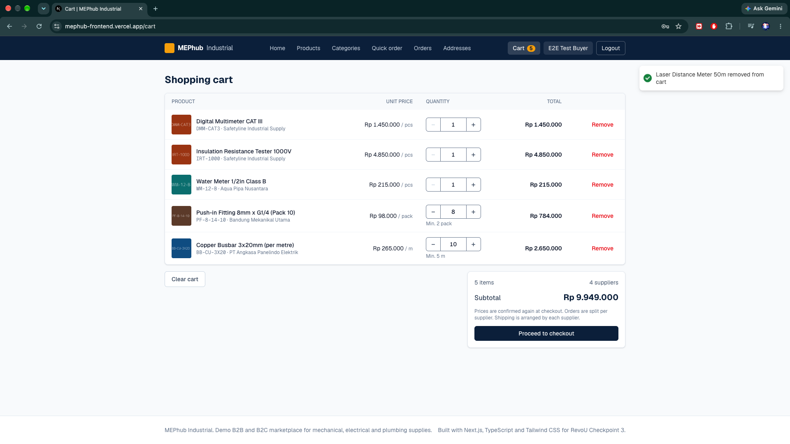 | 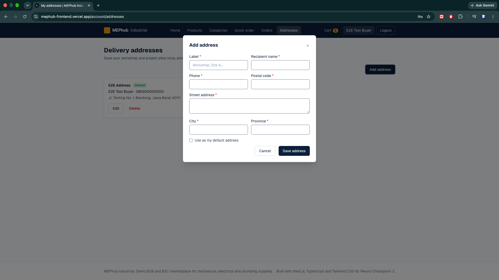 |
| 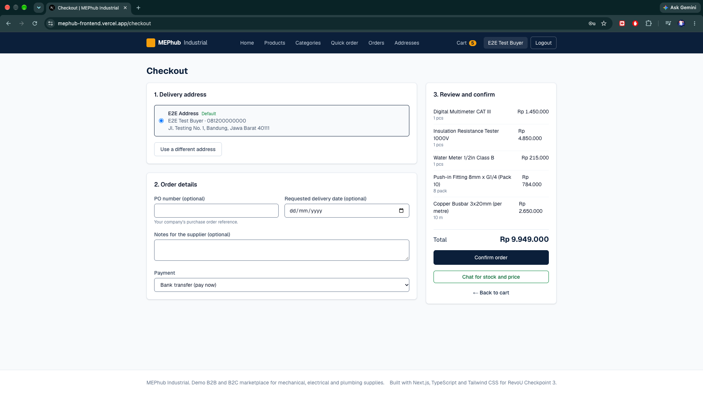 | 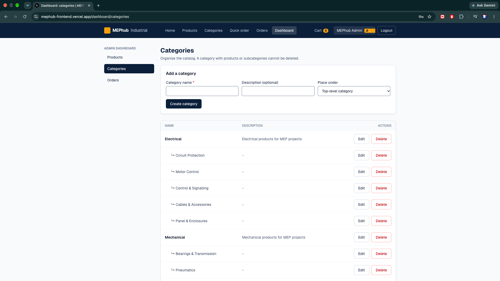 |

## Rendering strategy

| Route | Strategy | Why |
|---|---|---|
| `/`, `/products`, `/products/[id]`, `/categories` | Partial prerender: static shell, catalog data streamed from the API | Public data that changes often |
| `/login`, `/register`, `/cart`, `/checkout`, `/quick-order` | Static shell, client-side data | Depends on the browser (`localStorage`) |
| `/orders`, `/orders/[id]`, `/account/addresses` | Static shell, client-side data behind `ProtectedRoute` | Needs the logged-in user's token |
| `/dashboard`, `/dashboard/*` | Static shell, client-side data behind `AdminRoute` | Admin only |

## Deployment

The frontend is deployed on Vercel and redeploys automatically on every push to `main`. The API runs on Railway. The API's `CORS_ORIGINS` must list the Vercel address.

## Notes and limits

- The session token is kept in `localStorage` (as the course requires). A production system would use an `HttpOnly` cookie.
- The server is the source of truth for prices, stock and minimum order quantities; the browser only displays them.
- Payment is simulated: an admin marks bank transfers paid and approves payment terms.